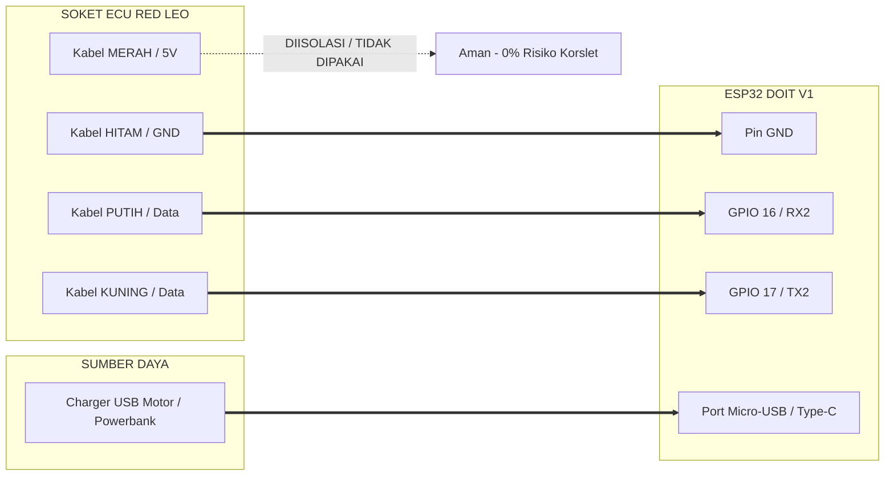

# 🏁 PANDUAN WIRING & ARSITEKTUR SISTEM RACE PANEL
### Motor: Yamaha MX King V1 | ECU: Red Leo Racing | Controller: ESP32 DOIT V1

Dokumen ini berisi panduan resmi pemasangan kabel, konfigurasi pinout, dan cara kerja sistem telemetri serta pengganti tombol mapping ECU Red Leo.

---

## 1. Skema Pinout Soket ECU Red Leo (Soket Hitam Bekas Tombol)

Dilihat dari bagian belakang soket kabel dengan posisi **LOCK (Pengait Klip) di SISI ATAS**:

```
                 [  L O C K  /  PENGAIT KLIP  ]
                        (Di Sisi Atas)
         ┌──────────────────────────────────────────────┐
Baris 1  │    [ Kosong ]       [ HITAM ]     [ Kosong ] │  <-- PIN GND (Massa)
         ├──────────────────────────────────────────────┤
Baris 2  │    [ MERAH ]        [ PUTIH ]     [ KUNING ] │
         └──────────────────────────────────────────────┘
                 ▲                ▲             ▲
                VCC              DATA          DATA
              (+3.3V DC)        (TX/RX)       (RX/TX)
```

### Keterangan Fungsi Jalur Kabel:
1. **Kabel HITAM (`-`)**: Jalur **Ground / Massa (GND)**.
2. **Kabel MERAH (`+`)**: Jalur **Power 3.3V DC** (hasil ukur ~3.2V) dari regulator internal ECU.
3. **Kabel PUTIH**: Jalur **Komunikasi Data Serial 1 (TX/RX - 3.3V Logic)**.
4. **Kabel KUNING**: Jalur **Komunikasi Data Serial 2 (RX/TX - 3.3V Logic)**.

---

## 2. Skema Penyambungan Aman ke ESP32 DOIT V1

Untuk mencegah beban arus berlebih pada regulator ECU, **ESP32 dinyalakan secara mandiri** menggunakan charger USB motor/powerbank. Jalur yang terhubung ke ECU hanya data dan ground:



### Tabel Rangkuman Sambungan Kabel:
| Dari Soket Tombol Red Leo | Sambungkan ke Pin ESP32 | Keterangan |
|---|---|---|
| ⚫ **Kabel HITAM (`-`)** | **Pin GND** | Wajib terhubung sebagai ground referensi serial |
| ⚪ **Kabel PUTIH (Data 1)** | **Pin GPIO 16 (RX2)** | Jalur penerima data telemetri dari ECU |
| 🟡 **Kabel KUNING (Data 2)** | **Pin GPIO 17 (TX2)** | Jalur pengirim perintah pindah map ke ECU |
| 🔴 **Kabel MERAH (`+`)** | *Tidak Perlu Disambung* | Bungkus dengan solasi bakar/isolasi listrik |

*(Catatan: Jika saat pengujian awal data telemetri belum terbaca, cukup tukar posisi kabel Kuning dan Putih pada pin GPIO 16 dan 17).*

---

## 3. Cara Kerja Sistem (Mode Bluetooth Racing - 4G Tetap Aktif)

```
[ ECU RED LEO ] 
      │ (Kabel Serial UART - 3 Kabel: Hitam, Putih, Kuning)
      ▼
[ ESP32 DOIT V1 ] 
      │ (Memancarkan Bluetooth SPP: "RacePanel-RedLeo")
      ▼
[ SMARTPHONE / HP ANDROID (Data 4G Tetap Nyala 100%) ]
      │ (Aplikasi: Serial Bluetooth Terminal / Bluetooth Electronics)
      ▼
[ RACE PANEL DASHBOARD & CONTROL ]
  • Stream Telemetri Real-time (~5-10ms latency)
  • RPM, AFR, Suhu Mesin (°C), Bukaan TPS (%), Voltase
  • Tombol Ganti Mapping: Tekan M1, M2, M3, M4 langsung dari HP!
```

---

## 4. Cara Menghubungkan HP ke ESP32 via Bluetooth

1. **Pairing Bluetooth:**
   * Buka menu **Bluetooth** di HP Anda.
   * Pindai perangkat baru, pilih: **`RacePanel-RedLeo`** ➡️ Klik **Pasangkan / Pair**.
2. **Pilihan Aplikasi Dashboard di HP (Play Store):**
   * **Aplikasi Rekomendasi 1: `Serial Bluetooth Terminal` (by Kai Morich)**
     * Buka aplikasi ➡️ Menu (garis 3) ➡️ **Devices** ➡️ Pilih **`RacePanel-RedLeo`**.
     * Klik ikon **Connect** di pojok kanan atas.
     * Data RPM, AFR, Suhu akan langsung mengalir secara *real-time*.
     * Di bagian bawah, atur tombol makro:
       * Tombol 1: `M1` (Map 1 - Harian)
       * Tombol 2: `M2` (Map 2 - Touring)
       * Tombol 3: `M3` (Map 3 - Race)
       * Tombol 4: `M4` (Map 4 - Backfire)
   * **Aplikasi Rekomendasi 2: `Bluetooth Electronics` (by Keuwlsoft)**
     * Memiliki panel tachometer jarum, angka digital besar, dan tombol sentuh kustom.
